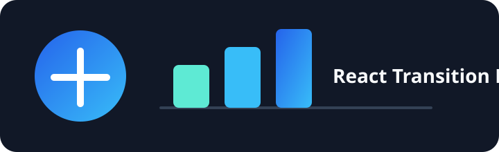

## 🔎 Overview
Explore React startTransition and useTransition by filtering a large local list while keeping input feedback responsive.

## ✨ Features
- ⚡ Compares immediate input state with deferred transition state
- 🧭 Shows the pending indicator while a transition is rendering
- 🔎 Filters a generated local catalogue without network requests
- 🧪 Includes a reset action and readable status output

## 🎬 Demo
No hosted demo is published. Run the project locally using the Quick Start command below.

## 🚀 Quick Start
    npm install && npm run dev

## 🧰 Tech Stack
- React 19
- TypeScript
- Vite

## 🗂️ Folder Structure
    src/App.tsx          React transition demonstration
    src/main.tsx         Application entry point
    src/style.css        Responsive interface
    index.html            Vite HTML shell
    vite.config.ts        Vite configuration

## 🛣️ Roadmap
- [ ] Add a startTransition sorting example
- [ ] Add a side-by-side urgent and deferred rendering timeline

## 🤝 Contributing
Issues and pull requests are welcome. Keep changes focused, document behavior, and add a small reproducible example for new features.

## 📄 License
Released under the MIT License. See LICENSE.

